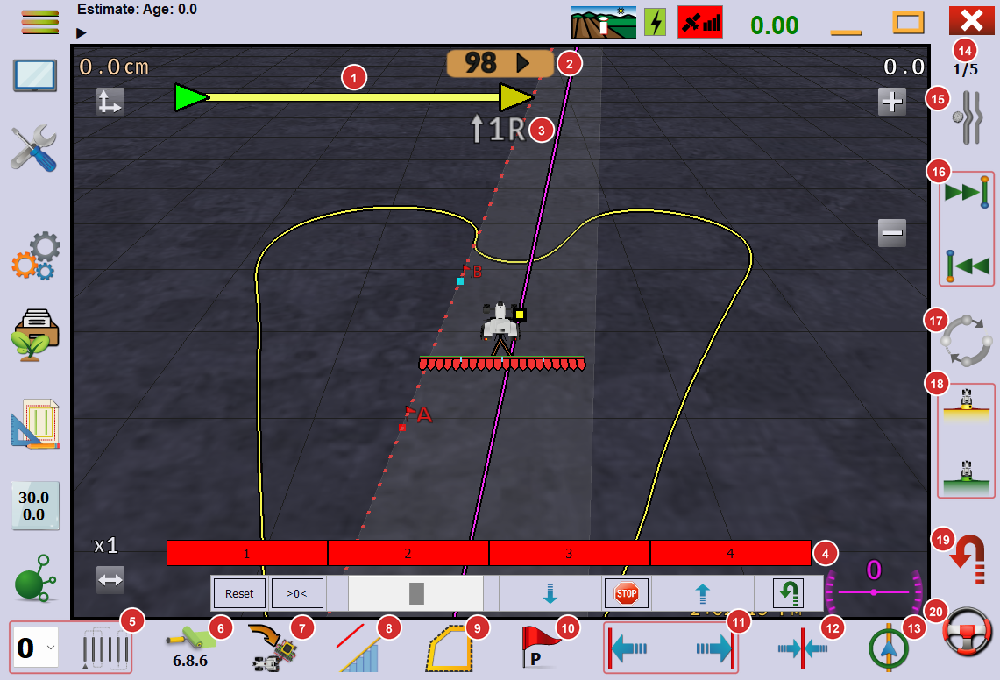
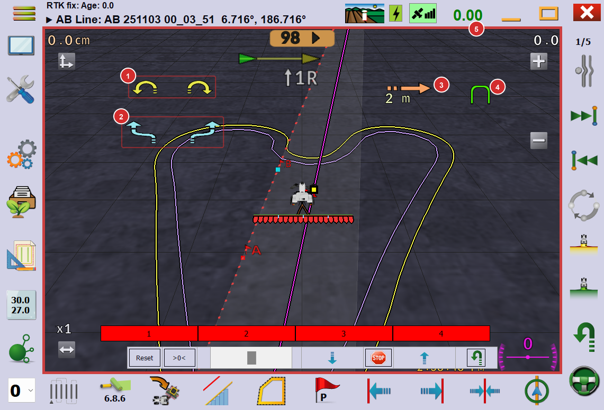
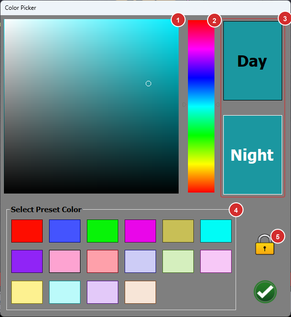
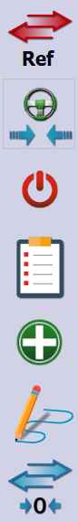
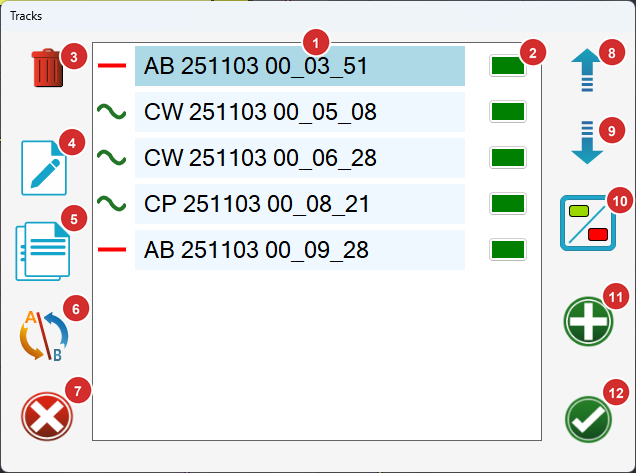
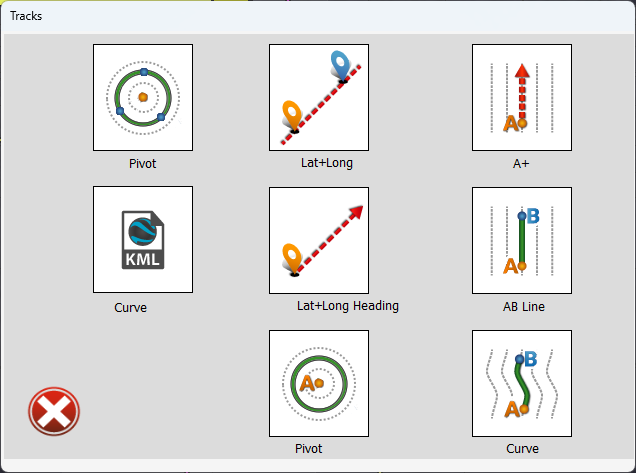
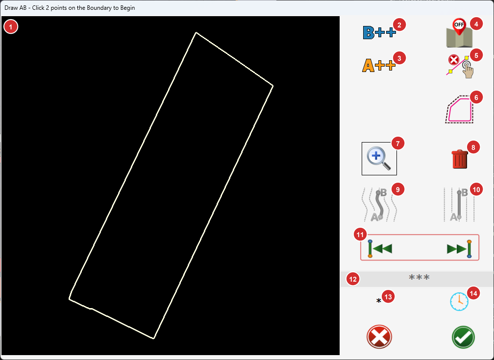
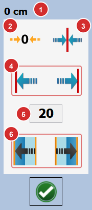
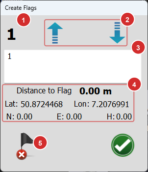

With a field open, AgOpenGPS guides you along **tracks**: straight AB lines,
curves and pivot circles. This page explains the buttons for tracks on the main
screen and the windows to make and edit them.

_Screenshots from AgOpenGPS 6.8.6._

## Main Screen With a Field Open

The screenshot shows a field with a boundary, a headland and an active AB line.
Most of these buttons only appear when they can be used, for example with a
track active or a boundary made. Some can also be hidden in the
[Configuration](/software/agopengps-orientation/configuration/) window, under
Features.

On the map:

1. **Steering Bar** – Shows how far the actual steer angle is from the angle
   AgOpenGPS asks for. Under Guidance Bar in the
   [Auto Steer](/software/agopengps-orientation/auto-steer/) window (On The Line
   tab), you can show a **Lightbar** instead, which shows the distance from the
   track as a row of dots, or switch it off.
2. **Distance** – How far the vehicle is from the track, in cm (or inches).
3. **Pass** – Which pass you're on, counted from the track to the right (**R**)
   or left (**L**). The arrow shows whether you're driving in the direction from
   A to B or the other way. If the track is nudged, the nudge distance is shown
   too.
4. **Sections** – The state of each section of the tool.

In the bottom bar:

5. **Skips** – The number sets how many passes a U-turn skips. The button
   switches between skips off, alternating skips, and skipping passes that are
   already worked.
6. **Section colour** – Sets the colour of the worked area (see
   [Section Colour](#section-colour)). The button also shows the version of
   AgOpenGPS.
7. **Reset tool heading** – Lines a trailing tool up behind the vehicle again.
8. **Headland section control** – Switches the sections off in the headland.
   Only shown with a headland.
9. **Headland** – Switches the headland on or off. Only shown with a headland.
   If the hydraulic lift is switched on (under Machine Module in the
   configuration), a button for it appears next to this one.
10. **Flag** – Puts a flag at the current position and opens the
    [Flags](#flags) window. Tap and hold it to choose the colour of the flag. The
    letter shows the steering method: **P** for Pure Pursuit, **S** for Stanley
    (see [Auto Steer](/software/agopengps-orientation/auto-steer/)).
11. **Nudge left and right** – Moves the track sideways by the step set in the
    [Nudge](#nudge) window.
12. **Snap to Pivot** – Moves the track to the current position of the vehicle.
13. **Tracks** – Opens the [track menu](#track-menu). If no track is active, the
    first tap switches one on.

With tram lines, one more button appears in the bottom bar. It switches between
the display modes of the tram lines.

On the right:

14. **Track number** – The active track and the number of tracks.
15. **Contour** – Guides you along the edge of the area you've already worked,
    instead of a track. With contour on, a lock button appears that keeps you on
    the current contour line.
16. **Next and previous track** – Switches to the next or the previous track.
    Autosteer switches off.
17. **Auto Track** – Switches to the closest track by itself, as long as
    autosteer is off.
18. **Section control** – Only one of these two buttons can be on at a time:
    - **Manual** (tractor over a yellow field): all sections are switched on,
      regardless of where you've already applied.
    - **Auto** (tractor over a green field): AgOpenGPS switches each section on
      and off by itself, depending on where you've already applied, the field
      boundary and the headland.
19. **U-Turn** – Turns automatically at the headland (see [U-Turn](#u-turn)).
    Only shown with a boundary.
20. **Auto Steer** – Switches autosteer on or off.

### U-Turn

With U-turn on, more buttons appear on the map. In the screenshot, autosteer
is on too.

1. **Manual U-turn** – Starts a U-turn to the left or the right right away. Tap
   it again to cancel. Not shown with Stanley.
2. **Lateral** – Moves to the next pass on the left or the right, without
   turning.
3. **Next U-turn** – The distance to the next U-turn and the direction it turns
   in. Tap it to turn the other way. The arrow is green when the U-turn is
   ready, and orange when it isn't.
4. **Turn style** – Switches between a U-turn and a K-turn (with reversing).
5. **Red frame** – Flashes when AgOpenGPS can't create the U-turn, or when the
   RTK fix is lost (with the RTK alarm on).

**Manual U-turn** and **Lateral** can be hidden in the
[Configuration](/software/agopengps-orientation/configuration/) window, under
Features.

### Section Colour

1. **Colour field** – How light and how strong the colour is.
2. **Colour bar** – The colour itself.
3. **Day** and **Night** – Show the colour in day and night mode.
4. **Preset colours** – Tap one to use its colour.
5. **Lock** – When it's unlocked, tapping a preset saves the current colour in
   it instead.

The green check mark saves the colour.

## Track Menu

The menu opens above the Tracks button. From top to bottom:

- **Ref** – Moves the saved track sideways, by a step or half a tool width. Unlike
  [Nudge](#nudge), this changes the track itself.
- **Auto Snap to Pivot** – Snaps the track to the vehicle each time autosteer
  switches on.
- **Tracks Off** – Switches the active track off.
- **Tracks** – Opens the [Tracks](#tracks) window.
- **Quick AB** – Makes a new track while you drive: an **AB Line** (set A, drive,
  set B), **A+** (set A and enter the heading) or a **Curve** (recorded while you
  drive).
- **Draw AB** – Opens the [Draw AB](#draw-ab) window.
- **Nudge** – Opens the [Nudge](#nudge) window.

## Tracks

1. **Track list** – The tracks of the field. The icon shows the type: a red line
   for an AB line, a green wave for a curve. Tap a track to select it.
2. **Visible** – Shows (green) or hides the track. Hidden tracks are skipped
   when you switch tracks on the main screen.
3. **Delete** – Deletes the selected track.
4. **Edit Name** – Renames the selected track.
5. **Duplicate** – Makes a copy of the selected track.
6. **Swap A and B** – Reverses the direction of the selected track.
7. **Cancel** – Closes the window and undoes all changes.
8. **Up** – Moves the selected track up in the list.
9. **Down** – Moves the selected track down in the list.
10. **Show/Hide all** – Shows or hides all tracks.
11. **New** – Makes a new track (see below).
12. **Use** – Makes the selected track active and closes the window.

### New Track

- **Pivot** (top left) – A circle for a centre pivot, found from points you add
  while you drive along it.
- **Lat+Long** – Enter the coordinates of A and B.
- **A+** – Set point A where you are and enter the heading.
- **Curve** (KML) – Loads a curve or an AB line from a KML file.
- **Lat+Long Heading** – Enter the coordinates of A and the heading.
- **AB Line** – Drive to the start, set point A, drive on and set point B.
- **Pivot** (bottom) – Also a circle for a centre pivot. Enter the coordinates
  of the centre.
- **Curve** – Set A and drive along the curve to record it, then set B.

At the end, you give the track a name. The clock button adds the date and time.

## Draw AB

Makes tracks on a map of the field.

1. **Map** – Tap two points on the boundary to begin, then tap **Curve** or **AB
   Line**.
2. **B++** – Makes the selected curve longer at the B end.
3. **A++** – Makes the selected curve longer at the A end.
4. **Mapping** – Shows or hides the worked area on the map.
5. **Delete points** – Clears the points you tapped.
6. **Boundary curve** – Makes a curve along the boundary.
7. **Zoom** – Zooms in on the map.
8. **Delete** – Deletes the selected track.
9. **Curve** – Makes a curve along the boundary between the two points.
10. **AB Line** – Makes an AB line through the two points.
11. **Previous and next track** – Selects a track.
12. **Name** – The name of the selected track.
13. **Number** – The number of the selected track.
14. **Time** – Adds the date and time to the name.

**Cancel** closes the window without saving; the green check mark saves the
tracks.

## Nudge

Moves the active track sideways, for example when the vehicle is a little off
the line you drove last time. The saved track doesn't change.

1. **Nudge distance** – How far the track is moved.
2. **Zero** – Moves the track back to where it was.
3. **Snap to Pivot** – Moves the track to the current position of the vehicle.
4. **Left and right** – Moves the track by the step.
5. **Step** – How far a tap on left or right moves the track, in cm.
6. **Half width** – Moves the track by half a tool width.

## Flags

Flags mark spots in the field, for example a stone or a wet patch.

1. **Number** – The number of the flag.
2. **Arrows** – Go through the flags.
3. **Name** – The name of the flag. You can change it here.
4. **Information** – The distance from the vehicle to the flag, its position
   (latitude and longitude) and its local coordinates (north, east and heading).
5. **Delete** – Deletes the flag.
